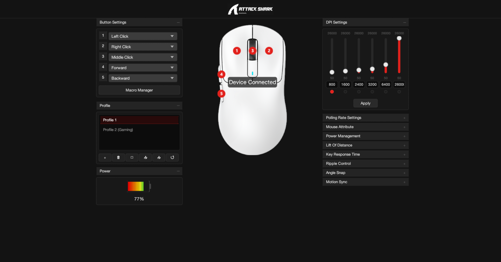

# Attack Shark X3 — Native Linux Driver & GUI

[](https://opensource.org/licenses/MIT)
[](https://www.rust-lang.org/)
[-blue.svg)]()

A native, independent, and open-source **Rust** implementation for complete configuration of the **Attack Shark X3** mouse on Linux, without relying on Wine or proprietary Windows software.




---

## Features

- **DPI Configuration**:
  - DPI stages adjustment (50 to 26,000 DPI in steps of 50).
  - Enable/disable and active stage selection.
  - Individual RGB color indicators for each DPI level.
- **Performance and Sensor (PixArt PAW3395)**:
  - Polling rate: 125 Hz, 250 Hz, 500 Hz, and 1000 Hz.
  - Lift-Off Distance (LOD): 1 mm and 2 mm.
  - Button response time (Debounce): 2 to 50 ms.
  - Ripple Control (On/Off).
  - Angle Snapping (On/Off).
  - Motion Sync (On/Off).
- **Power Management**:
  - Sleep time: 0.5 to 30 minutes.
  - Deep sleep time: 1 to 60 minutes.
  - Real-time battery level and voltage reading via HID.
- **Button Remapping**:
  - Individual configuration of the 5 physical buttons (Left Click, Right Click, Middle Click, Forward, and Back).
  - Multimedia functions, web navigation, DPI cycling, and custom shortcuts (key combinations).
- **Hardware Macros**:
  - Creation of key sequences and saving to the mouse firmware (Slot 2).
  - Direct execution by hardware without relying on software injection into the system.
- **Profiles and Persistence**:
  - Profile creation, switching, deletion, and restoration.
  - Automatic persistence in `~/.config/attack-shark-x3/config.toml`.
- **Native Graphical Interface**:
  - Built with `egui/eframe`, compatible with Wayland and X11 (GNOME, KDE Plasma, etc.).
  - Faithful visual reproduction of the original DuiLib interface.

---

## Installation and Execution

### 1. Prerequisites (Fedora / Ubuntu / Debian / Arch)

- **Fedora**:
  ```bash
  sudo dnf install -y rust cargo hidapi-devel
  ```
- **Ubuntu / Debian**:
  ```bash
  sudo apt install -y rustc cargo libhidapi-dev
  ```
- **Arch Linux**:
  ```bash
  sudo pacman -S rust hidapi
  ```

### 2. Configure Permissions (Udev Rules)

To allow the application to communicate with the mouse without requiring `sudo`:

```bash
sudo cp packaging/udev/99-attack-shark-x3.rules /etc/udev/rules.d/
sudo udevadm control --reload-rules && sudo udevadm trigger
```

### 3. Build and Run

```bash
# Build optimized release version
cargo build --release

# Run the graphical interface
./target/release/attack-shark-x3
```

---

## Project Structure

```text
attacksharkx3-linux/
├── Cargo.toml
├── README.md
├── LICENSE
├── assets/                  # Original visual assets and icons
├── docs/
│   ├── reverse-engineering.md  # Detailed reverse engineering report
│   ├── usb-protocol.md         # Complete HID protocol specification
│   └── compatibility.md        # Compatibility with distros and environments
├── packaging/
│   ├── udev/                   # Udev rules (99-attack-shark-x3.rules)
│   ├── desktop/                # .desktop shortcut for system menu
│   ├── deb/                    # Script to generate .deb package
│   ├── rpm/                    # Spec file to generate .rpm package
│   └── appimage/               # Script to generate AppImage
├── scripts/
│   └── install-udev.sh         # Helper script for installing permissions
├── src/
│   ├── main.rs                 # Executable entry point
│   ├── lib.rs                  # Reusable Rust library
│   ├── app.rs                  # Main eframe application loop
│   ├── protocol/               # Encoding and decoding of HID packets
│   │   ├── constants.rs
│   │   ├── checksum.rs         # 16-bit big-endian checksum calculation
│   │   ├── sensor.rs           # Report 0x04 (DPI, LOD, sensor)
│   │   ├── power.rs            # Report 0x05 (Sleep and debounce timers)
│   │   ├── polling.rs          # Report 0x06 (Polling rate)
│   │   ├── buttons.rs          # Report 0x08 (18-slot mapping)
│   │   ├── macro_upload.rs     # Report 0x09 (Macro block upload)
│   │   └── battery.rs          # Report 0x03 (Battery/voltage reading)
│   ├── device/                 # HID detection and communication via hidapi
│   ├── dpi/                    # Business rules and DPI validation
│   ├── buttons/                # Button actions and remapping
│   ├── macros/                 # Macro manager
│   ├── profiles/               # Profile manager
│   ├── config/                 # TOML persistence
│   └── gui/                    # egui/eframe visual components
└── tests/
    └── protocol_tests.rs       # Automated protocol and checksum tests
```

---

## Automated Tests

The project includes unit and integration tests that validate every byte of the constructed packets against real captures from the reference software:

```bash
cargo test
```

---

## License

Distributed under the [MIT](LICENSE) license.
